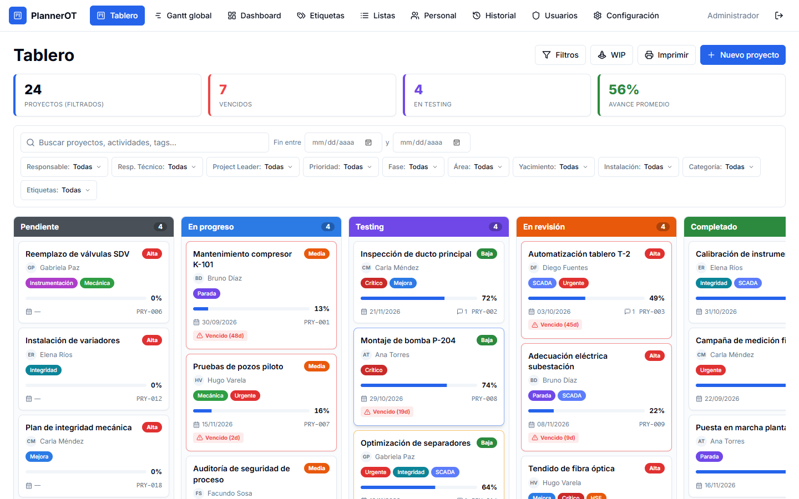
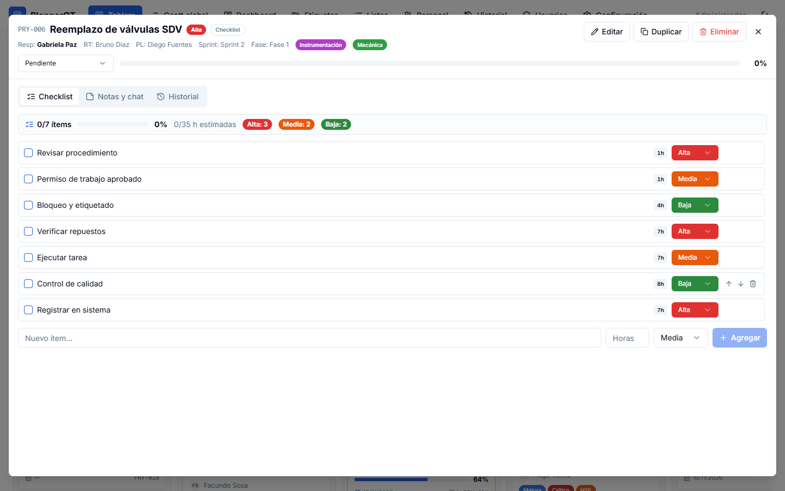

# OtPlanner · PlannerOT

**Planificación de proyectos industriales OT: tablero Kanban, Gantt interactivo, checklist con
horas, equipo y ausencias, auditoría y Excel — en una app web multiusuario con tiempo real.**

Migración completa del planificador monolítico `Kanban.html` (que guardaba todo en un `.xlsx`
desde el navegador) a una arquitectura cliente/servidor: **FastAPI + SQLAlchemy + SQLite/PostgreSQL**
en el backend y **Next.js 16 + React 19 + Tailwind 3 + shadcn/ui** en el frontend, con autenticación
JWT, roles, WebSocket y API REST documentada.





---

## Funcionalidades

- **Tablero Kanban** con drag & drop entre estados, KPIs en vivo, 10 filtros multi-select,
  lógica AND/OR de etiquetas, búsqueda global, rango de fechas y **límites WIP** por columna.
- **Gantt por proyecto**: arrastre de barras con **cascada de dependencias** finish-to-start,
  líneas de dependencia SVG, reordenamiento de filas, hitos ◆, fila de ausencias del equipo,
  zoom y ancho de columna ajustables, fines de semana y línea de hoy.
- **Gantt global** de todos los proyectos con filtros e impresión.
- **Modo Checklist** por proyecto con horas estimadas y demanda (Alta/Media/Baja); avance
  ponderado por peso en modo Gantt y por ítems hechos en modo Checklist.
- **Comentarios por actividad**, chat de proyecto, notas y enlaces.
- **Dashboard** con gráficos (estado, prioridad, carga por responsable, área), vencidos/por
  vencer y horas de checklist.
- **Etiquetas y listas desplegables** con renombrado que **propaga** a todos los usos.
- **Personal y ausencias** (Vacaciones/Trámite/Franco/Franco Generado) con matemática de francos.
- **Historial de cambios** auditado por usuario y fecha.
- **Multiusuario en tiempo real**: cada cambio se broadcastea por WebSocket a todas las sesiones.
- **Excel compatible con el Planner original**: export/import de las 11 hojas (`Proyectos`,
  `Actividades`, `Etiquetas`, `Listas`, `Comentarios_Act`, `Historial_Cambios`, `Subtareas`,
  `Hitos`, `Personal`, `Ausencias`, `Checklist_Proyecto`).
- **Modo oscuro**, navegación barra superior o sidebar, 4 estilos de tabla, impresión,
  y diseño responsive (el tablero scrollea horizontal en móvil).

## Stack

| Capa | Tecnologías |
|---|---|
| Backend | Python 3.13 · FastAPI · SQLAlchemy 2.0 · Pydantic v2 · SQLite/PostgreSQL · JWT (python-jose) · bcrypt · slowapi · openpyxl |
| Frontend | Next.js 16 (App Router) · React 19 · TypeScript · Tailwind 3 · shadcn/ui (Radix) · TanStack Query 5 · axios · recharts · lucide-react |
| Tiempo real | WebSocket `/ws` con invalidación de cache del cliente |
| Config | `backend/config.yaml` (YAML tipado) · `frontend/public/runtime-config.js` (API URL sin rebuild) |

## Puesta en marcha

### 1. Backend

```bash
cd backend
python -m venv .venv
.venv/Scripts/pip install -r requirements.txt     # Windows (Linux: .venv/bin/pip)
copy config.yaml.example config.yaml              # editar secret JWT y CORS
.venv/Scripts/python -m uvicorn app.main:app --host 127.0.0.1 --port 8000
```

Al arrancar con la base vacía se hace **seed idempotente** desde `base_docs/demo.xlsx`
(dataset ficticio generado por `scripts/generate_demo_xlsx.py`) y se crea
el usuario administrador. API y docs interactivas: `http://localhost:8000/docs`.

### 2. Frontend

```bash
cd frontend
npm install
npm run dev          # http://localhost:3000
# producción:
npm run build && npm start
```

La URL del backend se edita en `frontend/public/runtime-config.js` sin necesidad de rebuild.

### 3. Ingresar

Usuario inicial del seed: **`admin` / `admin123`** (cambiarla en *Usuarios* tras el primer ingreso).

## Tests

```bash
cd backend && .venv/Scripts/python -m pytest tests/ -q     # 24 tests de API, reglas y seed
```

## Estructura

```
backend/    API FastAPI: core (config/db/security/ws), models, schemas, crud (reglas), api, utils (seed/excel)
frontend/   Next.js App Router: lib (api/services/types), hooks, components (board/project/personal/ui), app/(app)
base_docs/  Kanban.html original, demo.xlsx (seed ficticio), arch.md y style.md (documentos base)
scripts/    generate_demo_xlsx.py (regenera el dataset demo de forma determinista)
docs/       Capturas de la aplicación
Project.md  Documentación completa: arquitectura, modelo de datos, reglas de negocio, API, paridad
```

## Documentación

Toda la arquitectura, el modelo de datos, las reglas de negocio (rollup, cascada, propagación,
francos), el contrato de API, el sistema visual y la matriz de paridad con el monolito original
están en **[Project.md](Project.md)**.

## Notas

- `backend/config.yaml` y la base SQLite **no se versionan** (contienen secrets/datos);
  usar `config.yaml.example` como plantilla.
- **Privacidad:** el repo contiene únicamente datos ficticios (`demo.xlsx` y capturas generadas
  con él). El Excel real del negocio (`bd.xlsx`) está ignorado por git y nunca se publica.
- Para PostgreSQL: cambiar `database.type` en `config.yaml` (mismo ORM, sin cambios de código).
- El import de Excel (solo admin) **reemplaza** los datos actuales; el export es no destructivo.